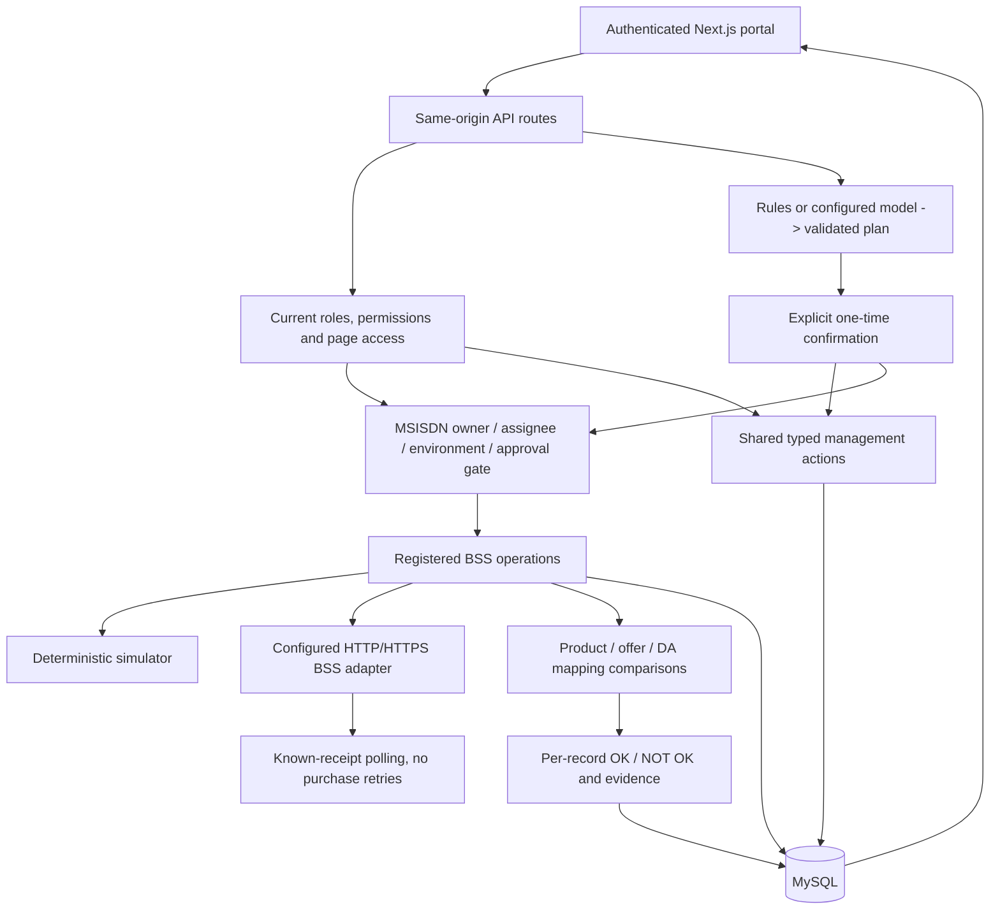

# Architecture

The current backend remains modular Next.js route handlers; existing purchase logic is retained. Extracting these services to NestJS is a future architectural option, not a dependency of the consolidated feature set.

- `lib/db.ts`: lazy MySQL initialization, parameterized queries, connection-bound transactions, salted password hashes, hashed session tokens, additive legacy migration and optional SQLite compatibility.
- `lib/policy.ts`: roles, pages, operation permissions, ownership/sharing and active/approval controls.
- `lib/management.ts`: common typed user, role, registry, approval, environment, operation and settings actions. The GUI and assistant invoke the same implementation.
- `lib/bss.ts`: relative-path normalization, registry matching, request/subject validation, upstream credentials, HTTP/HTTPS, TLS policy, bounded response size, masked evidence and purchase receipt polling.
- `lib/verification.ts`: CSV parsing, complete batch authorization before calls, configurable source operations and product-associated offer/DA/unit comparisons.
- `lib/assistant.ts`: deterministic natural-language parsing or an OpenAI-compatible planner, strict plan validation, explicit confirmation, expiry, ownership and replay prevention. The model cannot execute arbitrary endpoints.
- `lib/portal-api.ts`: shared operations, Subscriber 360, batch reports and account recovery.
- `scripts/portal.mjs`: project-root environment/config loading, configurable host/port, signal forwarding and startup independent of the caller's directory.

MySQL stores accounts, session hashes, login throttling and typed JSON documents for roles, settings, subscribers, plans, runs, audits and evidence. On first MySQL initialization, the original `.data/ptat.sqlite` is opened read-only and copied additively. Existing target records win; a marker makes the copy restartable and prevents repeated migration. Existing source files and legacy password hashes are retained; sessions are intentionally not migrated.

Management changes serialize on the central settings row, protecting role/assignment invariants. Plan execution claims use row locks; an assistant plan moves to EXECUTING before external calls and is never automatically replayed after ambiguous failure. Purchase requests are not retried. Polling is bounded by environment settings, and global request-status reads require a known receipt linked to an authorized subscriber.

This is synchronous execution suitable for local/UAT validation. Durable distributed workers, cross-process per-MSISDN execution serialization, transaction outbox, immutable audit, HA, enterprise SSO and campaign maker/checker workflows remain future work. Live schema mappings must be checked against the deployed BSS version.

Use existing checkouts in isolated cloud tasks; do not create a Git worktree unless the user requests one.
