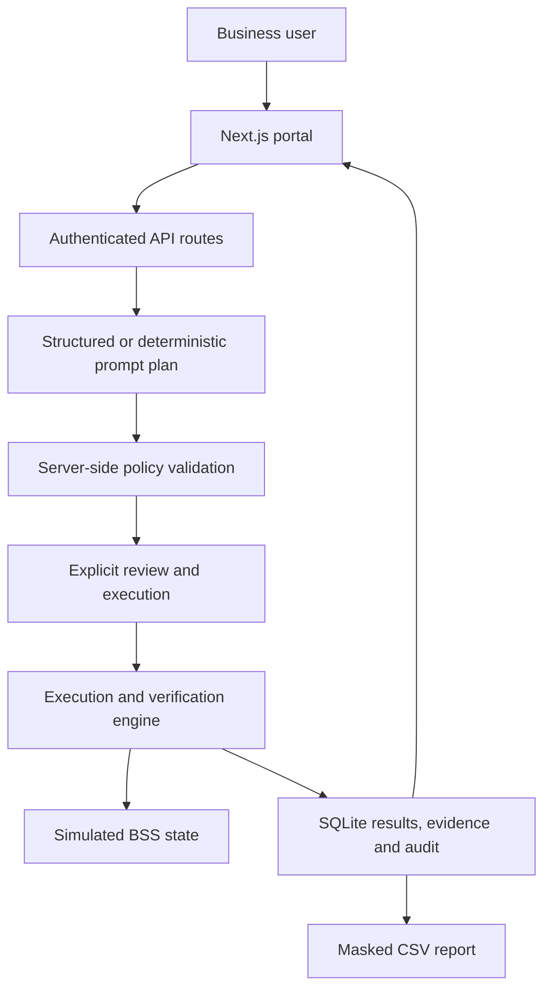

# Architecture

## Current runnable slice

`lib/engine.ts` contains policy and execution functions. `lib/catalog.ts` holds demo expectations and approved API path metadata. `lib/db.ts` owns local persistence and sessions. `app/api/[...path]/route.ts` enforces authentication, origin checks, and result access. The UI never receives a BSS credential and cannot submit a custom endpoint.

A purchase plan captures a product and subscriber IDs. Execution revalidates role, ownership, active status, environment and product. The SQLite transaction saves a run, changes the plan to EXECUTED, and records audit atomically. Execution is synchronous in this demo; it is not a queue or a distributed idempotency guarantee. Simulated scheduled/completed events are deterministic and are not actual timing/polling validation.

## Enterprise implementation milestones

1. Extract the authenticated backend to NestJS and migrate entities to MySQL. Introduce organization/user memberships, product expectation versions, encrypted evidence, retention and permission grants. Replace demo identities with approved SSO.
2. Implement a typed BSS adapter based on the current deployed contract. Resolve MSISDN → subscription ID, product eligibility, currency/charging units, entitlements and dedicated-account semantics. Add TLS-only hostname allowlisting, scoped secret-manager auth, timeout limits and bounded polling.
3. Redis-backed worker jobs: bounded concurrency, per-MSISDN serialization, durable progress, cancellation between safe steps, outbox, and purchase reconciliation on unknown outcomes. Never retry an ambiguous purchase automatically.
4. Expand the independent expected-result engine to real pre/post snapshots, tax/fee rules, existing entitlements, validity/timezone, async provisioning, and eventual consistency.
5. Add CSV/XLSX import, reusable versioned test cases, suites and campaigns, approvals and defect integration. Version and hash reports/evidence.
6. Introduce an approved enterprise model endpoint that produces the same strict plan schema. Retain human review and server-side policy; retrieved API documentation is data, never executable instruction. No arbitrary tool URLs.
7. Production readiness gate: security review, authorization testing, encrypted managed HA persistence, immutable audit, backups/restore drills, observability, secret rotation, TLS ingress, WAF, load testing and release CI.

Use existing checkouts in isolated cloud tasks; do not create a Git worktree unless the user requests one.
